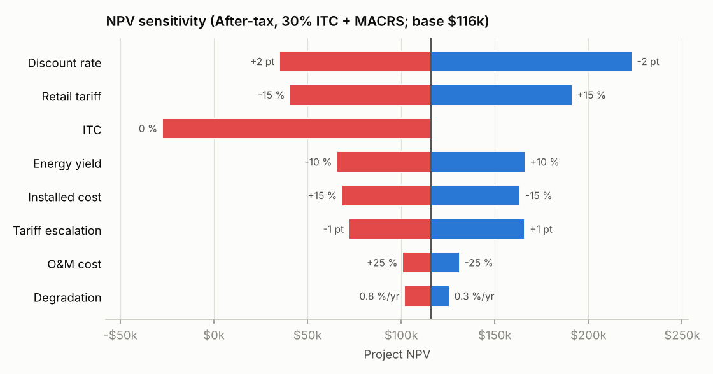
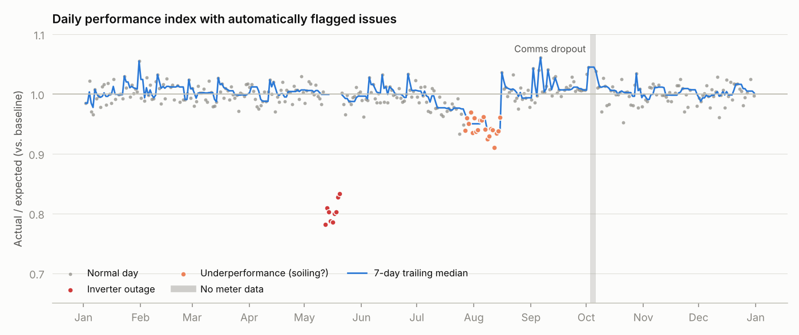
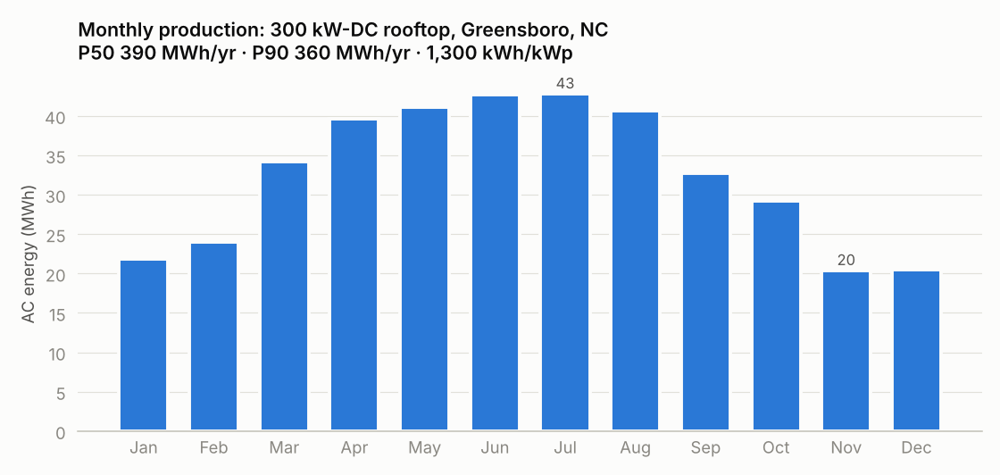
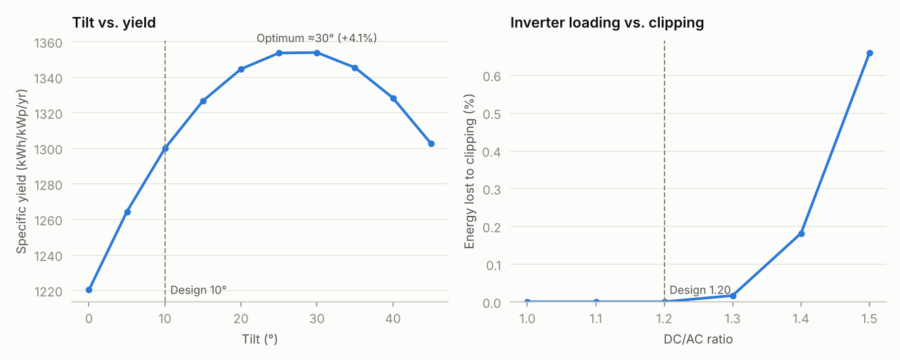
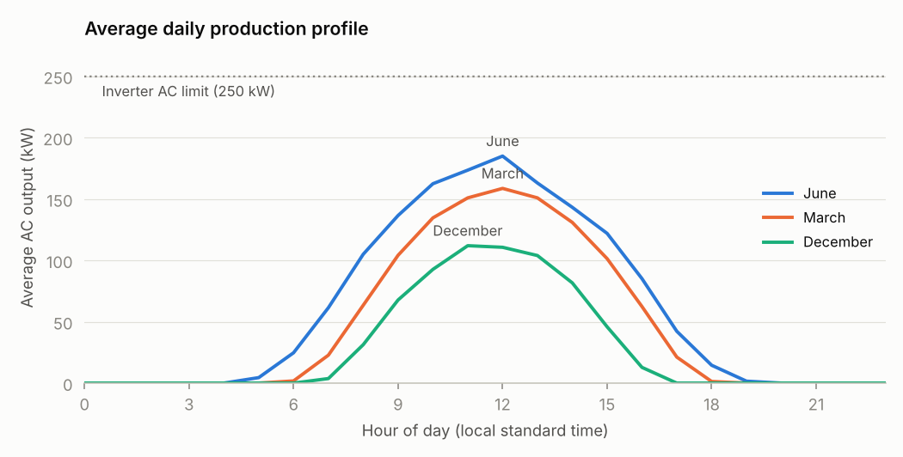
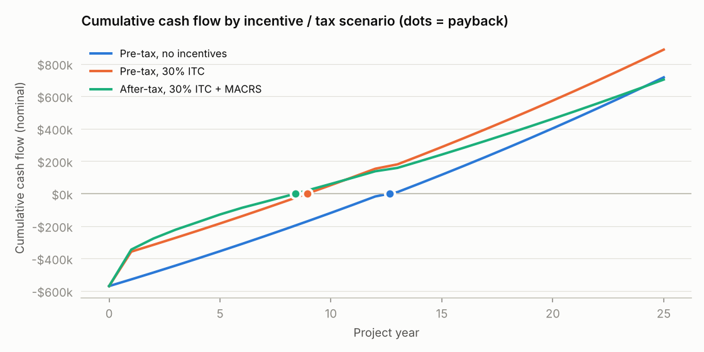

# Commercial Rooftop Solar: Yield, Financials & Performance Monitoring

[](https://github.com/blkdynamite/Solarproject/actions/workflows/ci.yml)


An end-to-end analysis of a **300 kW-DC rooftop PV system on a commercial warehouse in Greensboro, NC**, packaged as a tested, configurable Python tool. It covers three parts of the job that commercial solar analysts do every day:

1. **Energy yield.** Hourly simulation with [pvlib](https://pvlib-python.readthedocs.io/), P50/P90 estimates, and the tilt and DC/AC-ratio design trade-offs.
2. **Project financials.** 25-year cash flow, NPV, IRR, payback and LCOE. It covers pre-tax and after-tax (ITC + MACRS) views and includes a sensitivity analysis.
3. **Performance monitoring.** A causal fault detector that finds inverter outages, soiling and data gaps in a year of meter data, scored against ground truth with Monte Carlo testing.

```bash
make install   # pip install -c requirements-lock.txt -e ".[dev]"
make run       # full analysis -> results/  (~5 s)
make check     # ruff + mypy + pytest, exactly what CI runs
```

---

## Key results

### Energy

| Metric | Value |
|---|---|
| Annual production (P50 / P90) | **390 / 360 MWh/yr** |
| Specific yield | 1,300 kWh/kWp/yr |
| Capacity factor | 14.8 % |
| Performance ratio | 78 % |
| Plane-of-array insolation | 1,662 kWh/m²/yr |
| Clipping loss at 1.2 DC/AC | ≈ 0 % (0.18 % at 1.4, 0.66 % at 1.5) |

P90 assumes a combined 6 % (1σ) uncertainty from inter-annual weather variability plus model error, with a normal approximation (P90 = P50 × (1 − 1.282σ)).

### Financials (25 years, $570k installed)

| | Pre-tax, no incentives | Pre-tax, 30 % ITC | After-tax, 30 % ITC + MACRS |
|---|---|---|---|
| NPV @ 7 % | –$7k | +$153k | **+$116k** |
| IRR | 6.9 % | 10.4 % | **10.1 %** |
| Simple payback | 12.6 yrs | 8.9 yrs | **8.4 yrs** |
| Discounted payback | > 25 yrs | 14.9 yrs | 15.0 yrs |
| LCOE (flat, break-even) | $0.151/kWh | $0.115/kWh | $0.115/kWh |

- **Without incentives** the project roughly breaks even against a $0.12/kWh tariff.
- **With the ITC** it clears a 7 % hurdle comfortably.
- **The after-tax view** is how a taxable commercial owner would actually evaluate it. Energy savings raise taxable income, while O&M and 5-year MACRS depreciation (on a basis reduced by half the ITC) reduce it. Accelerated depreciation pulls the payback forward even though the 25-year NPV is lower than the pre-tax ITC case, because the savings themselves are taxed. Even at **P90 production**, the after-tax NPV stays positive at **+$77k**.



The base-case NPV is most sensitive to the **discount rate**, the **retail tariff** and **ITC eligibility**. Losing the ITC flips the after-tax NPV to about –$28k. Yield, capex and tariff escalation matter about equally, and O&M and degradation are second-order. In practice, that tells you where diligence effort should go.

### Performance monitoring

I simulated a year of meter data with three hidden problems and wrote a detector that flags them by comparing actual output with modelled (expected) output each day:

| Injected problem | Detected as | Detected | Latency | Impact |
|---|---|---|---|---|
| Inverter 3 offline, 12–20 May | Inverter outage (1 of 5 down) | 12–20 May, 9/9 days | same day | 1,927 kWh lost |
| Soiling during dry spell, 1 Jul–15 Aug (0 → 8 %) | Underperformance | 27 Jul–15 Aug | 26 days (loss ≈ 4.5 %) | 1,540 kWh lost on flagged days |
| Data-logger comms dropout, 3–5 Oct | No data | 3–5 Oct, 3/3 days | same day | 2,263 kWh unmetered, *not* counted as loss |

**No false positives** for this run (seed 42). One seed can be lucky, so `solar-rooftop evaluate-detector` reruns the whole experiment over 200 independent noise realisations:

| Over 200 realisations | Result |
|---|---|
| Inverter outage: recall / latency / misclassified | 100 % / 0 days / 0 |
| Comms dropout: recall / latency | 100 % / 0 days |
| Soiling: detection latency | mean 21 days (range 5–34) |
| False-positive days per year | mean 0.18 (out of ~290 healthy days); ≥ 1 in 29 of 200 runs |



The soiling latency is the expected trade-off. A gradual 8 % ramp has to rise above the day-to-day noise before it can be called. Tightening the threshold from 3 % to 2.5 % cuts the mean latency to about 17 days but roughly doubles the false-alarm rate. The threshold is a single config value, so an O&M team can tune it to its own tolerance for truck rolls.

## Charts

| | |
|---|---|
|  |  |
|  |  |

---

## Project structure

```
├── config/greensboro_300kw.toml   # every model input (site, system, finance, monitoring)
├── src/solar_rooftop/
│   ├── config.py      # frozen, validated dataclasses loaded from TOML
│   ├── weather.py     # TMY3 loading, mid-hour timestamp alignment
│   ├── energy.py      # hourly PV model, KPIs, P90, parameter sweeps, clipping
│   ├── finance.py     # cash flows, NPV/IRR/payback/LCOE, tax, sensitivity
│   ├── monitoring.py  # synthetic meter data, causal fault detector, scoring
│   ├── plotting.py    # report charts
│   ├── pipeline.py    # orchestration + Monte Carlo detector evaluation
│   └── cli.py         # `solar-rooftop run | evaluate-detector`
├── tests/             # 49 tests, 96 % coverage
├── results/           # generated charts, summary.json, CSVs
└── .github/workflows/ci.yml       # lint, type-check, test on 3.11–3.13
```

### Design decisions

- **Config, not code.** Assumptions live in a TOML file and load into frozen, validated dataclasses. Unknown keys and out-of-range values fail fast with a clear message. A new site or sensitivity case is a new config file, and `summary.json` records the exact inputs used for every run.
- **Pure functions, thin orchestration.** The modelling modules have no I/O or plotting, so each is unit-testable in isolation, and `pipeline.py` is the only place that writes files.
- **A causal detector.** Every daily decision uses only data up to that day, so it behaves exactly as it would running nightly on a live monitoring platform. A test checks this directly: changing future data must not change past classifications.
- **Tested against invariants, not just snapshots.** For example: NPV at the IRR is zero; an LCOE tariff gives NPV = 0; the pre-tax LCOE matches the textbook formula; the AC output never exceeds DC or the inverter rating; yield scales linearly with array size; and outage, soiling and comms faults are detected across several random seeds.
- **Reproducible.** Seeded randomness, `requirements-lock.txt` for exact versions, and a CI job against the newest allowed versions to catch upstream breakage early. (That already paid off: pvlib's TMY3 reader fails on pandas 3, so pandas is capped at `<3`.)

## Method

**Weather.** TMY3 typical-year data for Greensboro Piedmont Triad Airport (bundled with pvlib). TMY3 values are integrals over the hour *ending* at the timestamp, so timestamps are shifted to mid-hour for accurate sun positions.

**Irradiance.** Transposition to the array plane uses the Hay-Davies model, with beam angle-of-incidence losses from a physical IAM model.

**Cell temperature.** SAPM model, open-rack glass/polymer modules.

**DC/AC power.** PVWatts DC model (–0.35 %/°C), 14 % system losses, and the PVWatts inverter model at a 1.2 DC/AC ratio (5 × 50 kW). Clipping loss is the gap between the inverter efficiency curve with and without its AC limit.

**Financials.** Annual end-of-year cash flows with 0.5 %/yr degradation, 2.5 % tariff and O&M escalation, and an inverter replacement in year 13. The ITC is realised in year 1. IRR uses Brent's method. LCOE is defined as the flat $/kWh price at which NPV = 0, which keeps it consistent across pre-tax and after-tax views. The after-tax case assumes a 23 % blended tax rate and enough tax appetite to use depreciation losses as they occur.

**Fault detection.** The daily performance index (PI) is actual ÷ expected energy over the hours that have meter data:

1. Days with no or partial meter data raise a *data* alarm and are never counted as lost production, so a comms fault isn't mistaken for a plant outage.
2. Very overcast days (< 1 kWh/kWp expected) are skipped because the ratio is noisy when there is little sun.
3. The PI is normalised by a trailing 60-day median of healthy days. This absorbs any constant model bias, so the thresholds are relative to how *this* plant normally performs.
4. A sudden step down of at least half an inverter's share (≥ 10 % for 5 inverters), relative to the last few days, is flagged as an **inverter outage**, along with the estimated number of inverters down. A drop of more than 50 % is a **major outage**.
5. A trailing 7-day median more than 3 % below baseline is flagged as **underperformance** (soiling, shading, degradation). A step back up to baseline, such as rain or a panel wash, resets the trend so the alarm clears immediately.

Synthetic meter data includes 1.5 % day-level model error (such as irradiance mismatch between the weather source and the site) plus 2 % independent hourly noise.

## Design notes and trade-offs

- **Tilt.** The optimum tilt is about 30° (+4 % yield vs 10°). Commercial flat roofs still usually use 5–15° ballasted racking. Low tilt means less wind load, lighter ballast (roofs have weight limits) and tighter row spacing, so more modules fit on the roof, which outweighs the per-panel gain.
- **Clipping.** At 1.2 DC/AC this site essentially never reaches the inverter limit, and even at 1.4 clipping costs < 0.2 % of energy. A developer could push the ratio to 1.3–1.4 to cut inverter cost per kWh.
- **Tariff.** A real analysis would model the building's hourly load and actual utility tariff, including demand charges and export rates under net metering. A flat $/kWh avoided rate is a simplification.

## Limitations and assumptions to check

- **Incentives.** Installed cost, tariff and incentive eligibility vary a lot by state, project size and timeline. Federal legislation in 2025 tightened the deadlines for solar projects to qualify for the ITC, so treat the ITC scenarios as illustrative and confirm eligibility for any real project.
- **Tax view.** The after-tax case uses one discount rate for both views and ignores bonus depreciation, state incentives and financing (debt or tax equity).
- **P90.** The P90 is a normal approximation, not a multi-year (e.g. NSRDB) exceedance analysis.
- **Synthetic meter data.** Real SCADA data has additional failure modes (timestamp drift, stuck sensors, partial-string faults), and expected energy would normally come from on-site irradiance sensors rather than TMY.

## CLI

```bash
solar-rooftop run [--config FILE] [--out DIR] [--seed N] [--no-plots]
solar-rooftop evaluate-detector [--config FILE] [--seeds N]
```

`run` writes `summary.json` (all inputs and KPIs), `cash_flows.csv` (year-by-year for every scenario), `sensitivity.csv`, `daily_performance.csv` (the detector's daily status and diagnostics) and six charts to the output directory.

## Possible extensions

- Pull real weather for any site from NREL's NSRDB or PVGIS and run a multi-year P50/P90.
- Model a real hourly building load to split self-consumption from export.
- Add battery storage for demand-charge reduction.
- Run the detector on public operating-plant data (e.g. NREL PVDAQ).
