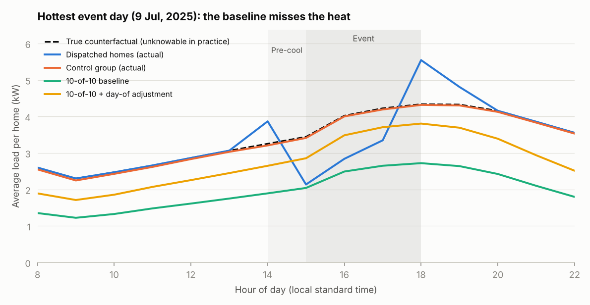
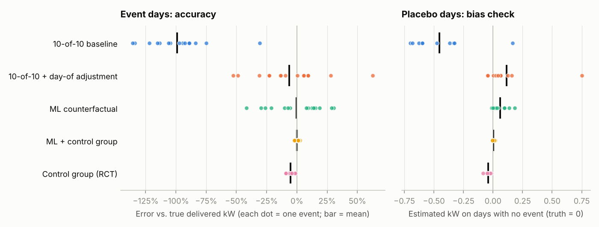
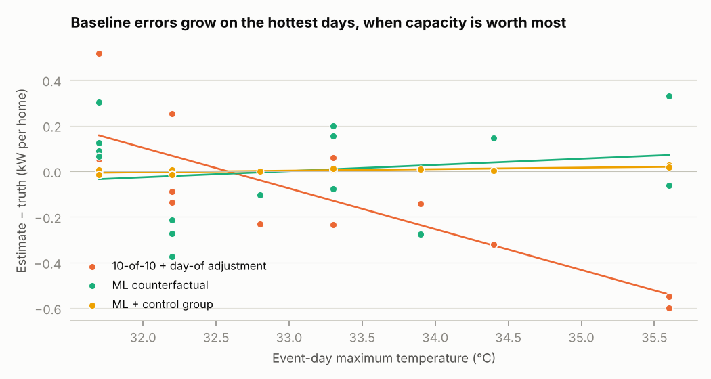
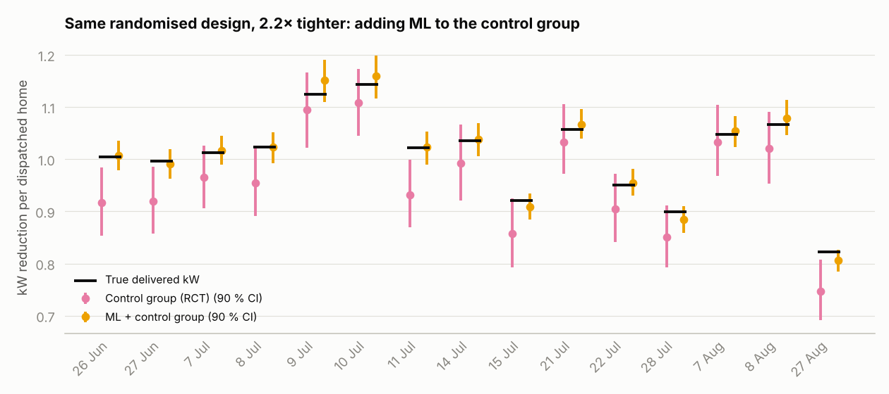
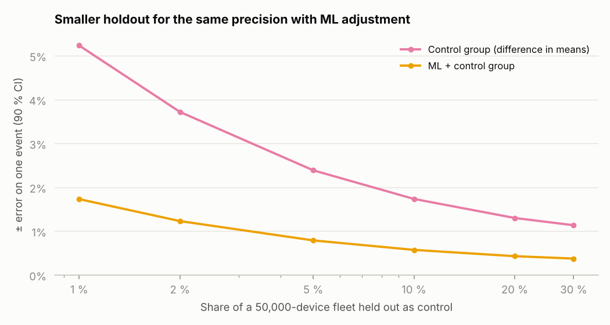

# Thermostat demand response: how much did the fleet deliver?

*Measurement & verification (M&V) study · 2,000 smart thermostats · 15 summer
events · simulated data with known ground truth.*

## Bottom line

1. **Each dispatched home delivered 1.01 kW** (90 % CI
   0.99–1.03) over the 3-hour event
   window. The true value, known here because the data is simulated, is 1.01 kW. At
   program scale (50,000 devices) that is **50 MW, worth about
   $5.04M/yr** in avoided capacity at $100/kW-yr.
2. **The industry-standard baseline gets this badly wrong.** The 10-of-10 baseline credits
   -0.01 kW per home (-101 %), a
   −$5.07M/yr misstatement. The usual day-of adjustment
   gets the season average within 8 %, but only because two
   errors partly cancel; single events are off by up to 63 %.
3. **Recommendation: evaluate with a randomised control group plus an ML counterfactual.** It
   was within 0.3 % of the truth for the season and within
   2 % on every single event, and across 20 independent simulated fleets its 90% confidence interval contained the truth 100% of the time. A
   **1% holdout** (0.5 MW set aside) is enough for
   ±1.7 % precision on each event; a plain control-group comparison would need a 10% holdout (5.1 MW forgone) for the same precision.

## Comparing methods

| Method | Season kW/home (90 % CI) | Season error | Worst event error | Placebo kW (truth 0) | Annual misstatement |
|---|---|---|---|---|---|
| 10-of-10 baseline | -0.01 (-0.02–0.01) | -101 % | 136 % | -0.45 | −$5.07M |
| 10-of-10 + day-of adjustment | 0.93 (0.91–0.94) | -8.2 % | 63 % | +0.11 | −$413k |
| ML counterfactual | 1.01 (0.99–1.02) | +0.2 % | 42 % | +0.06 | $9k |
| ML + control group | 1.01 (0.99–1.03) | +0.3 % | 2 % | +0.00 | $14k |
| Control group (RCT) | 0.96 (0.90–1.01) | -5.3 % | 9 % | -0.04 | −$265k |

*Program scale: 50,000 devices at $100/kW-yr.
Placebo days are the hottest weekdays with no event, so every method should report ~0 kW.*

## Why the standard baselines fail

- **Events are called on the hottest days, and the baseline days are cooler.** A 10-of-10
  baseline averages the previous ten non-event weekdays, so on a heatwave day it
  under-predicts what homes would have used and erases most of the reduction. Back-to-back
  events make it worse: excluding recent event days pushes the baseline further back into
  milder weather. Its error grows by -0.20 kW per home for every 1 °C
  of daily maximum temperature.
- **Pre-cooling contaminates the day-of adjustment.** The adjustment rescales the baseline
  to match load in the hours just before the event, but dispatched thermostats pre-cool in
  that window. The median adjustment factor is 1.58 for dispatched homes vs
  1.49 for identical control homes on the same days. That inflation
  over-credits the program and partly offsets the heat bias above: luck, not a method.
- **An ML model on its own is not enough either.** It is trained on non-event days, and
  events are, by design, the hottest days of the year, so it must extrapolate beyond most of
  what it has seen. This season it was +0.2 % for the season and
  off by up to 42 % on single events (across 20 independent fleets its season error had a standard deviation of 5.5 points, and its interval contained the truth only 15% of the time), while
  its confidence interval only reflects sampling noise, not model error: precise is not the
  same as accurate.
- **The placebo test exposes all three without needing the truth.** On the hottest days
  *without* an event, every method should estimate 0 kW. That check works on real data, and it
  is the first thing I would run on any production M&V method.

## Why ML plus the control group works

Randomisation makes the control group an unbiased stand-in for the dispatched homes, so the
control group's ML prediction error on the event day measures the model's bias on that exact
day, and subtracting it cancels the bias. Meanwhile the ML prediction explains most of the
home-to-home variation in load (event-window spread falls from 0.72 kW to
0.24 kW per home), so the estimate is
**2.2× more precise** than a plain difference in means. This is the same
idea as CUPED variance reduction in online A/B testing.

Note how the plain control-group estimates in this fleet sit below the truth on most events.
That is not bias: every event reuses the same randomly assigned homes, so one unlucky split
shifts every event the same way. It is also why per-event checks within one season can't
validate a method's error bars. 

### Validation across 20 independent fleets

The whole study was repeated on 20 fresh fleets (new homes, random assignment and noise;
same weather and event days). A trustworthy method has a mean error near zero and a
90% interval that contains the truth about 90% of the time.

| Method | Mean season error | Error SD (pts) | RMSE | 90% CI contains truth | Avg CI half-width |
|---|---|---|---|---|---|
| 10-of-10 baseline | -100 % | 0.7 | 100.1 % | 0% | ±1.3 % |
| 10-of-10 + day-of adjustment | -7.6 % | 0.6 | 7.6 % | 0% | ±1.7 % |
| ML counterfactual | +2.9 % | 5.5 | 6.1 % | 15% | ±1.5 % |
| ML + control group | -0.2 % | 0.9 | 0.9 % | 100% | ±1.9 % |
| Control group (RCT) | +0.1 % | 2.9 | 2.9 % | 100% | ±5.5 % |

With 20 fleets, coverage is only a rough check: a perfectly calibrated 90%
interval contains the truth in all 20 runs about 12% of the time, so 100 %
is consistent with calibration but suggests the intervals may be slightly conservative. The
baselines and the standalone ML model fail because their intervals reflect sampling noise
only, not their systematic error.

## How big should the control group be?

Every held-out device delivers zero kW, so the holdout has a direct cost. Precision for a
single event in a 50,000-device program:

| Holdout | Control devices | ± error, control group only | ± error, ML + control | Capacity forgone |
|---|---|---|---|---|
| 1% | 500 | ±5.2 % | ±1.7 % | 0.5 MW / $51k |
| 2% | 1,000 | ±3.7 % | ±1.2 % | 1.0 MW / $101k |
| 5% | 2,500 | ±2.4 % | ±0.8 % | 2.5 MW / $253k |
| 10% | 5,000 | ±1.7 % | ±0.6 % | 5.1 MW / $505k |
| 20% | 10,000 | ±1.3 % | ±0.4 % | 10.1 MW / $1.01M |
| 30% | 15,000 | ±1.1 % | ±0.4 % | 15.2 MW / $1.52M |

## Data quality

The data layer (DuckDB SQL, structured like a dbt project) deduplicated
11,582 retried readings out of 5,802,438, found
1.1 % of device-hours missing and
38 devices with multi-day outages. A device-event is
included only with a complete event window, adjustment window and ten baseline days;
94% of dispatched device-events and
94% of control device-events qualified. The same rule
applies to both groups, so exclusions can't bias the comparison. All
4 SQL data tests passed.

## Method notes

- **Fleet:** 2,000 homes with heterogeneous cooling load (balance point, sensitivity,
  AC size, behaviour), driven by Greensboro, NC weather. Events: 3 h from
  15:00, called on the 15 hottest weekdays, with
  1 h pre-cool, 2 h snapback, overrides that rise with
  heat, and 3% of devices missing the signal. 20% of homes
  are randomly held out as control.
- **ML model:** a pooled gradient-boosted regressor (scikit-learn) trained on non-event days,
  with weather, calendar, device-fingerprint and same-morning load features. Validation on
  held-out days: 12 % CV(RMSE) per device-hour,
  -0.3 % fleet-level bias. Most useful features: morning_kw (39%), temp_4h (22%), dev_hod_kw (18%), temp_12h (9%).
- **Uncertainty:** Poisson cluster bootstrap over devices (500 replicates),
  90% percentile intervals; devices are the clusters, so season-level
  intervals account for the same homes appearing in every event.
- **Limitations:** simulated homes are simpler than real ones (no humidity, occupancy
  schedules or solar gain on specific walls), and the true effect is the average over
  dispatched homes that reported data. On real data the truth is unknown, so placebo tests,
  holdout comparisons and pre-period validation replace the "error vs truth" columns.
